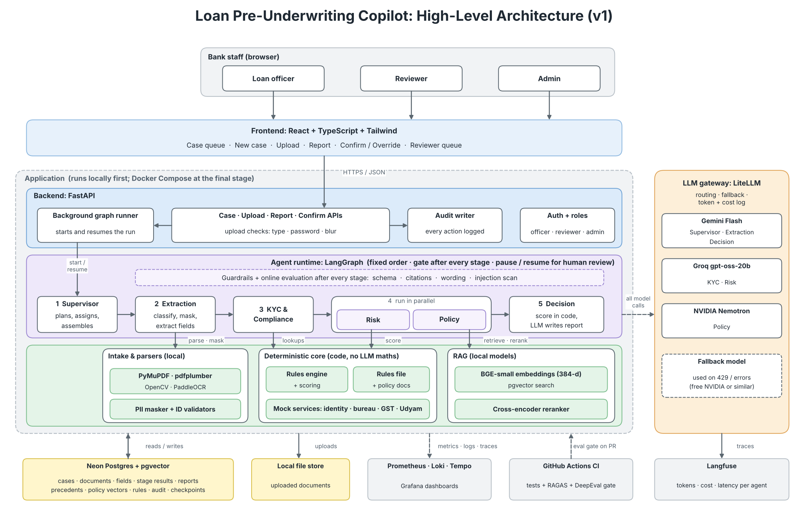
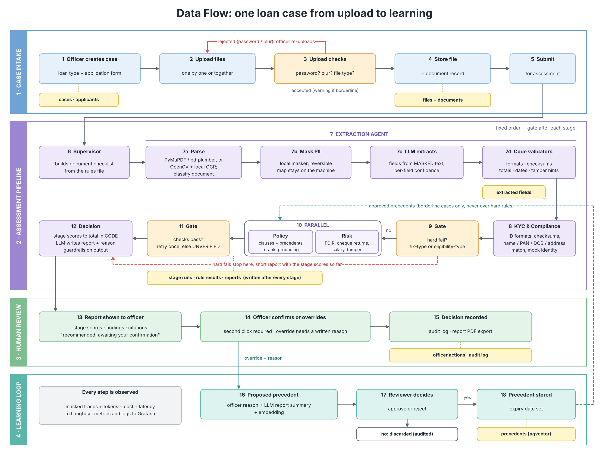

# ARCHITECTURE

Companion to `PRD.md`. Diagrams are in `diagrams/` (regenerate with `python3 diagrams/make_diagrams.py`).





## 1. Principles

1. **Human always decides.** The system recommends; the loan officer confirms.
2. **Scoring is code.** LLMs extract, explain and write. They never calculate scores or decide hard rules.
3. **Rules and policy live in files**, not code, so a company can swap them.
4. **No raw PII leaves the machine.** Mask first, then call any cloud model.
5. **Fixed order, gated.** Predictable pipeline; every stage output is checked before the next stage runs.
6. **Everything is traceable:** rule ID, policy clause, model, tokens, cost, version.

## 2. Components

| Component | Role | Tech |
|---|---|---|
| Frontend | Queue, case form, upload, report, confirm/override, admin precedent queue | React, JavaScript, CSS |
| API | Auth and roles, case, upload and report endpoints, audit writes, starts and resumes runs | FastAPI |
| Upload checks | Type, size, password-protected rejection, blur and crop score | Python in the API process |
| Intake and parsers | Text and table extraction, OCR, classification, PII masking, ID validators | PyMuPDF, pdfplumber, OpenCV, PaddleOCR (Tesseract fallback) |
| Agent runtime | Multi-agent graph with gates, pause and resume | LangGraph, Postgres checkpointer |
| Rules engine | Evaluates rules file, computes stage scores, hard-fail logic | Pure Python |
| Mock services | Identity, bureau, GST, Udyam lookups from synthetic records | Python, Postgres tables |
| RAG | Policy and precedent retrieval, rerank, grounding check | BGE-small (384-d), cross-encoder, pgvector |
| LLM gateway | Routing per agent, fallback on 429 and errors, token and cost logs | LiteLLM |
| Database | Relational and vector data in one place | Neon Postgres with pgvector |
| File store | Uploaded documents | Local disk (v1) |
| Observability | Traces, tokens, cost; metrics, logs, dashboards | Langfuse; Prometheus, Loki, Tempo, Grafana |
| CI | Tests, evaluation gate on PRs | GitHub Actions, RAGAS, DeepEval |

## 3. Agent graph

```
START → supervisor → extraction → gate_E → kyc → gate_K ─┬─ hard fail → decision(short) → END(review)
                                                          └─ ok → [policy ‖ risk] → gate_PR → decision → END(review)
```

- **Fixed edges.** The Supervisor LLM does supervision work (checklist, task hand-off, retries, final summary), not route choice.
- **State** carries: case ID, applicant list (primary, co), document handles, extracted fields, stage results, flags, retry counters, model-used log.
- **Gates** are code: hard-fail check, confidence threshold, schema validity, citation validity. A failed check retries once, then marks the stage `unverified` and continues to the officer.
- **Pause and resume:** after `decision` the graph pauses at `await_officer` (status `awaiting_confirmation`; a fix-type stop ends with status `stopped` instead). A stopped case resumes from its failed stage after corrections. LangGraph checkpoints live in Postgres.
- **Co-applicant:** extraction, KYC and risk run once per person with a role tag; decision aggregates.
- Details per agent: `AGENTS.md`.

## 3b. API and background runs (Stage 6)

- FastAPI under `/api/v1` (`backend/app/api/`: `auth`, `cases`, `admin`, `runner`, `reportpdf`). One process: the API, the graph runner and, if `frontend/dist` exists, the built frontend.
- **Runs are asyncio tasks** on the API's event loop (`runner.py`), not Celery. `POST /cases/{id}/submit` returns 202 at once; the page polls `GET /cases/{id}/status`, which reads `stage_runs` rows as each stage finishes. A failed run puts the case back to `uploaded` (or `stopped`) and writes `pipeline_failed` to the audit log. On start-up the app continues every case left in `running` from its Postgres checkpoint (`Runner.recover`).
- **Entry points:** `Pipeline.start` (submit), `Pipeline.resume_after_fix` (`POST /cases/{id}/resume`, with the corrected form and the whole current file list), `Pipeline.officer_action` (`POST /cases/{id}/confirm` and `/override`).
- **Roles:** every `/cases` route is officer-only and limited to the officer's own cases (another officer's case is a 404); `/admin` routes are admin-only. An admin account therefore cannot create, upload, submit or confirm, and an officer cannot reach the precedent queue, the Users routes or the summary.
- **Admin users (Stage 8, `app/api/users.py`):** `GET /admin/users`, `GET /admin/summary` (counts only), `POST /admin/users` (name, email, role), `POST /admin/users/{id}/disable`, `/enable`, `/reset-password`. The server makes the temporary password (three groups of four characters, from `secrets`), returns it once in the response and stores only its argon2 hash; neither it nor any hash goes to the audit log. Audit actions: `user_created`, `user_disabled`, `user_enabled`, `user_password_reset`. An admin cannot disable their own account, and the last active admin cannot be disabled. A disabled user's token stops working at once (the role and `active` flag are read from the database on every request). No new migration. The role is read from the database on every request.
- **Second click:** `confirm` and `override` return 422 unless the body has `second_click: true`; an override also needs a reason of at least 15 characters and a decision different from the recommendation. The UI sends `second_click` only from the button inside the second dialog.
- **Uploads:** `check_upload` per file (type by signature, size, password, blur, crop). A rejected file is never written to disk; its row stays with the reason. Accepted files are stored under a generated name in `UPLOAD_DIR/<case id>/`. The document type chosen at upload is a hint for the checklist; Extraction classifies the file itself.
- **Display:** the API returns PAN as `ABCDE****F`, Aadhaar as `XXXX XXXX 1234`, phone as `******1464`, GSTIN as `08PPIPM****`; a corrected form that leaves a masked value keeps the stored one.

## 3c. Customer notifications (Stage 9, planned)

A small `notifications` module on the API side, outside the agent graph and never an input to scoring. Parts: templates in code, a content checker, a `Sender` interface with the console sender as the only v1 implementation, outbox rows, and routes to draft, check, send and list. Flow: the officer opens a draft after confirm, override or a stopped run; the server runs the content check; a second confirmation sends; the console sender prints the message in the backend terminal; the outbox row and audit log record it. No model is called, so masking does not apply to the message text, and the message never contains case data by design. See `SECURITY.md` section 4b.

## 4. Model routing

| Agent | Primary | Why |
|---|---|---|
| Supervisor, Extraction, Decision | Gemini Flash | Long context, document understanding, report writing |
| KYC, Risk | Groq gpt-oss-20b | Fast, cheap reasoning on structured data |
| Policy | NVIDIA Nemotron | Retrieval-grounded answering |
| Any (on 429 or error) | Fallback free model via LiteLLM | Keeps runs alive under free-tier limits |
| Evaluation judge | A lighter model from a different family than the generator | Avoids self-grading |

Providers are spread across agents to share the free quota. Verify model IDs and limits at Stage 1.

**Gemini and PDFs:** v1 never sends raw PDFs to a cloud model. Text is extracted locally (OCR for images), masked, then sent. Direct PDF reading is an optional switch for production with approved data.

## 5. Data and privacy flow

1. Original files stay on local disk.
2. Parsers produce text locally.
3. Local masker replaces PAN, Aadhaar, phone, account numbers and email with tokens; the reversible map stays on the machine.
4. Matching checks (name, PAN, DOB) run locally on unmasked values before masking.
5. Only masked text goes to any cloud LLM.
6. Langfuse traces contain masked text only.
7. Bureau data older than six months is deleted unless consent is renewed.

Full controls: `SECURITY.md`.

## 6. Learning loop in the architecture

Override → proposed precedent (reason + LLM summary + embedding) → hard-rule check in code, then admin approval → stored in `precedents` with an expiry. The Policy agent retrieves approved precedents only for borderline cases, same loan type, above a similarity threshold. A precedent can add a capped bonus and relabel a borderline case; it never overrides a hard rule. Main policy files are never edited by learning.

Built in Stage 7 (`app/learning/`): the `await_officer` node calls `propose_precedent` on an override. A masked LLM summary (code-written if the model fails its checks) is stored with the officer's reason; `hard_rule_breach` holds any proposal that would approve a case with a failed hard rule or a stop (`held`, never in the queue). The Decision node asks `precedent_bonus` for points (approve-final precedents only, `bonus_max` × similarity) and re-runs `score_case`, which refuses the bonus unless the case is refer band with no stop and no cap-to-refer rule. The report carries `precedents` and `precedent_bonus`.

## 7. Evaluation hooks

- After each agent: code checks (schema, recompute, citation exists, score equals code result). LLM judge only if the code checks are inconclusive.
- Offline: RAGAS and DeepEval on the 100-case golden set; GitHub Actions gate.
- Scores are logged to `eval_scores` and Langfuse.
- `python -m app.eval.run --split dev` replays the split through the rules engine (no database, no model), writes/compares `docs/baselines/`, and is the CI gate. `app.eval.fairness` is monitoring only.

### 7b. Observability (Stage 7)

- **Langfuse** (`app/observability/tracing.py`): one trace per case (id derived from the case id, so resumes join it), a span per stage, a generation per model call with model, tokens, cost, latency, fallback flag; evaluation scores attached at the end. No prompt, reply or document text is sent. Off without keys or with `LANGFUSE_ENABLED=false`; a tracing error never fails a case. `llm_calls.langfuse_trace_id` holds the id.
- **Prometheus** (`/metrics`, aggregate counters only), **Loki** (JSON lines in `logs/app.log` through Promtail), **Tempo** (OTLP spans when `OTEL_EXPORTER_OTLP_ENDPOINT` is set), **Grafana** (provisioned datasources and a "Loan Copilot" dashboard). Config in `ops/`; start with `docker compose -f ops/docker-compose.observability.yml up -d`, Grafana on port 3000.

## 8. Configuration

All via `.env` and the rules file; nothing secret in git.

| Setting | Notes |
|---|---|
| `DATABASE_URL` | Neon connection string |
| `GEMINI_API_KEY`, `GROQ_API_KEY`, `NVIDIA_API_KEY` | Free-tier keys |
| `LITELLM_CONFIG` | Per-agent model list and fallbacks |
| `LANGFUSE_*` | Cloud or local host and keys |
| `FILE_STORE_PATH` | Local upload directory |
| `RULES_PATH`, `POLICY_PATH` | Rule and policy files |
| `JWT_SECRET` | Auth signing |

## 9. Deployment

- **Development:** run API, frontend and worker directly on the laptop; Neon is hosted.
- **Final stage (Stage 10):** Docker Compose with frontend, API (graph runner inside), optional local Langfuse, Prometheus, Loki, Tempo, Grafana. Optional local Postgres service for offline use.
- **Later:** hosted file storage, Celery plus Redis if concurrency demands it, real API integrations behind the mock interfaces.

## 10. Failure behaviour

| Failure | Behaviour |
|---|---|
| Model 429 or error | LiteLLM fallback model; logged with `fallback_used` |
| Fallback also fails | Stage marked `unverified`, officer sees why |
| Low OCR or extraction confidence | Field flagged, never guessed |
| Process crash mid-run | Resume from last checkpoint |
| Guardrail failure | Retry once, then `unverified` |
| Database unavailable | API returns a clear error; runs pause, no partial writes |
