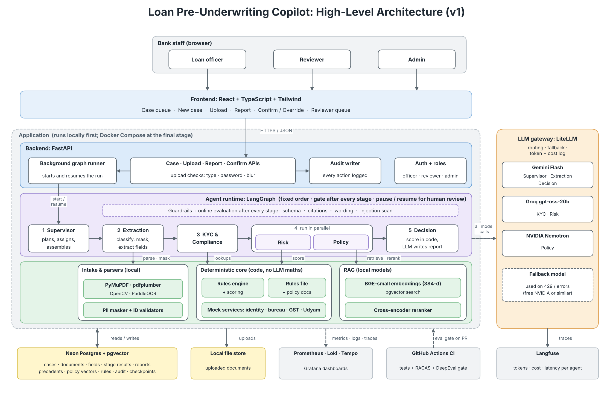
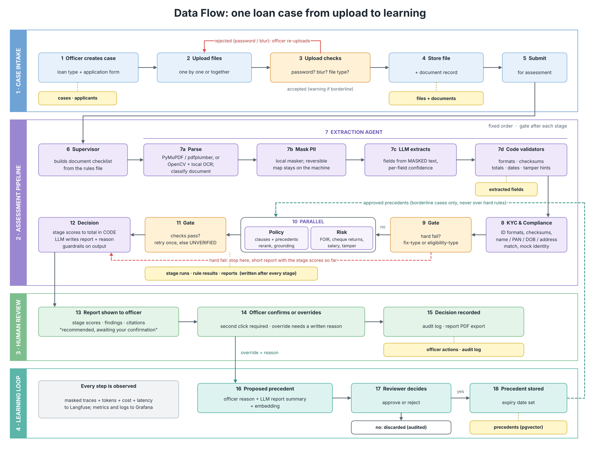

# ARCHITECTURE

Companion to `PRD.md`. Diagrams are in `diagrams/` (regenerate with `python3 diagrams/make_diagrams.py`).





## 1. Principles

1. **Human always decides.** The system recommends; the loan officer confirms.
2. **Scoring is code.** LLMs extract, explain and write. They never calculate scores or decide hard rules.
3. **Rules and policy live in files**, not code, so a company can swap them.
4. **No raw PII leaves the machine.** Mask first, then call any cloud model.
5. **Fixed order, gated.** Predictable pipeline; every stage output is checked before the next stage runs.
6. **Everything is traceable:** rule ID, policy clause, model, tokens, cost, version.

## 2. Components

| Component | Role | Tech |
|---|---|---|
| Frontend | Queue, case form, upload, report, confirm/override, admin precedent queue | React, JavaScript, CSS |
| API | Auth and roles, case, upload and report endpoints, audit writes, starts and resumes runs | FastAPI |
| Upload checks | Type, size, password-protected rejection, blur and crop score | Python in the API process |
| Intake and parsers | Text and table extraction, OCR, classification, PII masking, ID validators | PyMuPDF, pdfplumber, OpenCV, PaddleOCR (Tesseract fallback) |
| Agent runtime | Multi-agent graph with gates, pause and resume | LangGraph, Postgres checkpointer |
| Rules engine | Evaluates rules file, computes stage scores, hard-fail logic | Pure Python |
| Mock services | Identity, bureau, GST, Udyam lookups from synthetic records | Python, Postgres tables |
| RAG | Policy and precedent retrieval, rerank, grounding check | BGE-small (384-d), cross-encoder, pgvector |
| LLM gateway | Routing per agent, fallback on 429 and errors, token and cost logs | LiteLLM |
| Database | Relational and vector data in one place | Neon Postgres with pgvector |
| File store | Uploaded documents | Local disk (v1) |
| Observability | Traces, tokens, cost; metrics, logs, dashboards | Langfuse; Prometheus, Loki, Tempo, Grafana |
| CI | Tests, evaluation gate on PRs | GitHub Actions; own runners for the answer key, retrieval and the judge model |

## 3. Agent graph

```
START → supervisor → extraction → gate_E → kyc → gate_K ─┬─ hard fail → decision(short) → END(review)
                                                          └─ ok → [policy ‖ risk] → gate_PR → decision → END(review)
```

- **Fixed edges.** The Supervisor LLM does supervision work (checklist, task hand-off, retries, final summary), not route choice.
- **State** carries: case ID, applicant list (primary, co), document handles, extracted fields, stage results, flags, retry counters, model-used log.
- **Gates** are code: hard-fail check, confidence threshold, schema validity, citation validity. A failed check retries once, then marks the stage `unverified` and continues to the officer.
- **Pause and resume:** after `decision` the graph pauses at `await_officer` (status `awaiting_confirmation`; a fix-type stop ends with status `stopped` instead). A stopped case resumes from its failed stage after corrections. LangGraph checkpoints live in Postgres.
- **Co-applicant:** extraction, KYC and risk run once per person with a role tag; decision aggregates.
- Details per agent: `AGENTS.md`.

## 3b. API and background runs (Stage 6)

- FastAPI under `/api/v1` (`backend/app/api/`: `auth`, `cases`, `admin`, `runner`, `reportpdf`). One process: the API, the graph runner and, if `frontend/dist` exists, the built frontend.
- **Runs are asyncio tasks** on the API's event loop (`runner.py`), not Celery. `POST /cases/{id}/submit` returns 202 at once; the page polls `GET /cases/{id}/status`, which reads `stage_runs` rows as each stage finishes. A failed run puts the case back to `uploaded` (or `stopped`) and writes `pipeline_failed` to the audit log. On start-up the app continues every case left in `running` from its Postgres checkpoint (`Runner.recover`).
- **Entry points:** `Pipeline.start` (submit), `Pipeline.resume_after_fix` (`POST /cases/{id}/resume`, with the corrected form and the whole current file list), `Pipeline.officer_action` (`POST /cases/{id}/confirm` and `/override`).
- **Roles:** every `/cases` route is officer-only and limited to the officer's own cases (another officer's case is a 404); `/admin` routes are admin-only. An admin account therefore cannot create, upload, submit or confirm, and an officer cannot reach the precedent queue, the Users routes or the summary.
- **Login help line (no endpoint, no settings):** the login page shows the plain sentence "Can't sign in? Contact your admin." and nothing else: no email, no phone, no settings values, no request form. No new endpoint is exposed before sign-in.
- **Admin users (Stage 8, `app/api/users.py`):** `GET /admin/users`, `GET /admin/summary` (counts only), `GET /admin/users/{id}/activity` (an officer's case counts by status and band, confirm and override counts, precedents by status, last sign-in and the 10 latest case numbers; no applicant data), `POST /admin/users` (name, email, role), `POST /admin/users/{id}/disable`, `/enable`, `/reset-password`. The server makes the temporary password (three groups of four characters, from `secrets`), returns it once in the response and stores only its argon2 hash; neither it nor any hash goes to the audit log. Audit actions: `user_created`, `user_disabled`, `user_enabled`, `user_password_reset`. An admin cannot disable their own account, and the last active admin cannot be disabled. A disabled user's token stops working at once (the role and `active` flag are read from the database on every request). No new migration. The role is read from the database on every request.
- **Second click:** `confirm` and `override` return 422 unless the body has `second_click: true`; an override also needs a reason of at least 15 characters and a decision different from the recommendation. The UI sends `second_click` only from the button inside the second dialog.
- **Uploads:** `check_upload` per file (type by signature, size, password, blur, crop). A rejected file is never written to disk; its row stays with the reason. Accepted files are stored under a generated name in `UPLOAD_DIR/<case id>/`. The document type chosen at upload is a hint for the checklist; Extraction classifies the file itself.
- **Display:** the API returns PAN as `ABCDE****F`, Aadhaar as `XXXX XXXX 1234`, phone as `******1464`, GSTIN as `08PPIPM****`; a corrected form that leaves a masked value keeps the stored one.

## 3c. Customer notifications (Stage 9, built)

A small `notifications` module (`app/notifications/`: `templates.py`, `check.py`, `sender.py`) with routes in `app/api/messages.py` (and issue reports in `app/api/issues.py`) on the API side, outside the agent graph and never an input to scoring. Parts: templates in code, a content checker, a `Sender` interface with the console sender as the only v1 implementation, outbox rows, and routes to draft, check, send and list. Flow: the officer opens a draft after confirm, override or a stopped run; the server runs the content check; a second confirmation sends; the console sender prints the message in the backend terminal; the outbox row and audit log record it. No model is called, so masking does not apply to the message text, and the message never contains case data by design. See `SECURITY.md` section 4b. The sender is chosen by `NOTIFICATION_SENDER` (only `console` in v1) and held on `app.state.sender`, so tests can inject a failing sender. Optional `BRANCH_CONTACT_EMAIL` and `BRANCH_CONTACT_PHONE` add branch lines to every message. Issue reports (officer to admin) share the content check's personal-data patterns and the audit helper but are a separate table and router.

## 3d. Intake desk and upload link (Stage 10, Parts A to C built)

Everything here runs **before** Submit and ends in the same `Submission` the graph already reads; the graph, scoring and gates are unchanged.

```
zip / folder / files / applicant link
  -> safe unpack (intake/archive.py, in memory) -> upload checks -> read once (text layer or OCR) + classify + local extract
  -> read result saved next to the file (intake/readcache.py) -> duplicate rules -> person assignment (intake/inventory.py)
  -> inventory (received / missing / extra / unassigned / unrecognised / rejected / duplicate)
  -> identity prefill from PAN + Aadhaar (intake/prefill.py, officer ticks) -> claims by applicant request or officer -> Submit
```

- `api/ingest.py` is the one upload step for both doors (officer route `api/intake.py`, applicant route `api/public.py`). `api/filestore.py` is the `FileStore` interface (local disk now); files are served only by authenticated routes.
- Extraction (`agents/assemble.py`, `_early_read`) loads the saved read result when its hash and application date match and reads the file again only when the model pass needs the page text (never saved) or the date differs. No second OCR otherwise.
- The public routes (`/api/v1/public/*`) have no session. The token travels in the `X-Upload-Token` header and the page keeps it in the URL fragment (`/u#token`), which a browser never sends to a server, so it is in no access log. `api/ratelimit.py` limits per link and per address.
- `api/links.py` creates, lists, extends and disables links (officer for their own, admin naming an officer). "Ask the applicant" makes a link bound to a case. The "Upload link" message (Stage 9 outbox) carries the link added by code; the page holds the token in memory for the two calls and the server keeps only a placeholder.
- Part D (bundle PDF split, built 2026-11-18): `intake/bundle.py` proposes the split from each page's own title (the same local classifier), `api/ingest.py` (`Desk`) stores a multi-page PDF that looks like several documents as a row with status `bundle`, and `api/intake.py` saves the officer's edit (no dialog) and cuts on the second click (`confirm_split`): each piece is a PDF cut with PyMuPDF, checked, read from the pages already read, classified and filed like a file of its own, linked to the original by `parent_document_id`, `page_from`, `page_to`. The bundle is read twice (to propose, then to cut) because raw page text is never kept; a piece's PDF metadata is not judged (it describes the merging tool), so the piece carries the quality flag `from_bundle` instead.

## 3e. AI control (admin, 2026-11-18)

`app/services/ai_config.py` holds the configuration the pipeline uses: models per role, router settings, the model switch, temperature and length per role, and the published prompt texts, loaded from `ai_config_versions` and `ai_prompt_versions` over the file defaults (`llm_models.yaml`, `prompts/*.md`). The API starts with a `ConfiguredRouter` that looks like a LiteLLM router to the agents but forwards each call to the router of the configuration **bound to the running case**. `Runner` binds the active snapshot (a context variable) as each run starts, after a cheap check of the two version stamps, so a published change reaches the next case and never changes a running one. `AgentContext.models()` is the router or `None` when the admin switched models off (the agents then write their text in code). `app/api/ai_control.py` is the admin-only API; `app/agents/prompt_check.py` tries a draft prompt on a fixed synthetic sample with the real schema and guardrails.

## 3f. Knowledge base (admin, 2026-11-21)

Policy text lives in the database (`policy_documents.body`, one row per version with a lifecycle `status`); the files in `data/policy` are starting data imported by the re-index command when their label is new. `app/rag/policy_admin.py` is pure code (upload conversion, format check, auto-fix, comparison, rule-number drift, old-format import); `app/rag/policy_store.py` is the service behind `app/api/knowledge.py` (drafts in `policy_drafts`, staged and embedded when they pass, the retrieval check, publish, schedule, restore, retire, search, index health); `app/rag/versions.py` decides what is in force: it switches a scheduled version in when its date has come (on the next read, under an advisory lock, no scheduler) and gives the runner the set a new run binds (a context variable, like the AI configuration), which `PolicyRetriever` and the report's version stamp read. `app/learning/maintenance.py` pauses, confirms again and retires precedents and records their uses. The rules file is not reachable from the browser.

## 3g. Post-demo features (Stage 12, planned 2026-11-25)

None of these changes the graph order, the gates or a score.

- **Counter-offer (Part A).** `app/scoring/counter_offer.py` is pure code beside the engine. The Decision node calls it after the one scoring run (and after the precedent rescore), with the run's own `case_input` and `ScoreReport` from the state and the rules file. It calls `score_case` again with only the amount and tenure changed. The result goes into `Report.counter_offer`, which is saved in `reports.report_json`; nothing is sent to a model. The box is added after the summary is written, and an unexpected error in it is logged and the report goes out without a box (display only). The sentences are written in code and shown as stored by `CounterOfferBox` and the officer's PDF. A re-run after a fix makes a new report version with its own box.
- **Insights (Part B, built 2026-11-25).** `app/reporting/insights.py` builds every panel with SQL over `cases`, `reports`, `officer_actions`, `admin_actions`, `stage_runs`, `rule_results`, `precedent_uses` and the active policy's clause titles (`policy_chunks`). It lives in a new `app/reporting` package, not `app/monitoring`, so `app.monitoring` stays the isolated fairness view that no API module imports except to mount its router. `api/insights.py` serves it three ways: admin (with case references and officer ids for links), auditor (`strip_refs`: counts, rule and clause ids and officer names only), officer (`/me/insights`, own decisions). The band a precedent moved a case from is worked out by the scoring code's `band_for`. The browser sends the filter dates as instants (its own midnight), so the server needs no time zone setting. No model.
- **Export and decision timers (Part C).**
  - The CSV routes reuse `auditlog.csv_response`.
  - `app/workflow/sla.py` (pure) does the working-day maths and the due state.
  - The clock starts where the Decision node sets `awaiting_confirmation` (it writes `report_ready_at` and `sla_due_at` in the same transaction) and stops in `Pipeline.officer_action`.
  - A loop in the app (`run_sla_watch`, started like the retention job and the email worker, every `SLA_CHECK_MINUTES`, under an advisory lock) writes the overdue notices through `inbox.notify`, so they go in the same transaction as their audit row and follow the staff-email switch.
- **Score breakdown (Part D).** `agents/report.py` adds `Report.score_breakdown` (per stage: max, earned, lost; bonus; cap; band lines) when every stage ran. The case API adds it to an older stored report from its own stage scores, using the same function. The UI draws only. The report PDF (`api/reportpdf.py`) adds a "Points lost" column to its stage table from the same numbers; the chart is not in the PDF.
- **"Ask this case" (Part E).** `app/chat/` and `api/chat.py`, outside the graph:

```
officer or admin question (POST /cases/{id}/chat)
  -> access: case owner or admin (other officer 404, auditor 403); report must exist; rate limit per person
  -> models off? -> "Chat is off" (no call)
  -> mask the question (same masker; names tokenised) -> injection scan -> what-if check
        hit -> fixed text, audit row, no model call
  -> context (code): report facts, findings and rule evidence (masked), masked extracted fields,
     clauses: the report's cited clauses + top reranked clauses for the question,
     retrieved from the policy versions recorded on the report (bound like a run, E-91)
  -> model (role case_assistant via the configured router; fallbacks as usual)
  -> ChatAnswer schema -> code checks (citations exist, numbers match, wording, no raw identifiers)
        fail -> one retry with the reasons -> fail again -> fixed text
  -> store turn (case_chat_messages), llm_calls (stage chat), Langfuse span, audit row
  -> answer with citation chips (a clause chip opens the clause, as in the report)
```

  The chat routes write only `case_chat_messages`, `llm_calls` and `audit_log`; no route there can change a case, a score or a decision.

## 4. Model routing

| Agent | Primary | Why |
|---|---|---|
| Supervisor, Extraction, Decision | Gemini Flash | Long context, document understanding, report writing |
| KYC, Risk | Groq gpt-oss-20b | Fast, cheap reasoning on structured data |
| Policy | NVIDIA Nemotron | Retrieval-grounded answering |
| Case assistant chat (Stage 12, planned) | Gemini Flash | Long context, cited answers in plain words; outside the pipeline |
| Any (on 429 or error) | Fallback free model via LiteLLM | Keeps runs alive under free-tier limits |
| Evaluation judge | A lighter model from a different family than the generator | Avoids self-grading |

Providers are spread across agents to share the free quota. Verify model IDs and limits at Stage 1.

The table above is the file default. From Stage 10 the admin can change it from the AI control page (section 3e): each role's first choice and fallbacks come from the providers listed in `llm_models.yaml`; keys stay in `.env`.

**Gemini and PDFs:** v1 never sends raw PDFs to a cloud model. Text is extracted locally (OCR for images), masked, then sent. Direct PDF reading is an optional switch for production with approved data.

## 5. Data and privacy flow

1. Original files stay on local disk.
2. Parsers produce text locally.
3. Local masker replaces PAN, Aadhaar, phone, account numbers and email with tokens; the reversible map stays on the machine.
4. Matching checks (name, PAN, DOB) run locally on unmasked values before masking.
5. Only masked text goes to any cloud LLM.
6. Langfuse traces contain masked text only.
7. Bureau data older than six months is deleted unless consent is renewed.

Full controls: `SECURITY.md`.

## 6. Learning loop in the architecture

Override → proposed precedent (reason + LLM summary + embedding) → hard-rule check in code, then admin approval → stored in `precedents` with an expiry. The Policy agent retrieves approved precedents only for borderline cases, same loan type, above a similarity threshold. A precedent can add a capped bonus and relabel a borderline case; it never overrides a hard rule. Main policy files are never edited by learning. A published policy change pauses the precedents whose rules use a changed clause until the admin confirms them again (section 3f).

Built in Stage 7 (`app/learning/`): the `await_officer` node calls `propose_precedent` on an override. A masked LLM summary (code-written if the model fails its checks) is stored with the officer's reason; `hard_rule_breach` holds any proposal that would approve a case with a failed hard rule or a stop (`held`, never in the queue). The Decision node asks `precedent_bonus` for points (approve-final precedents only, `bonus_max` × similarity) and re-runs `score_case`, which refuses the bonus unless the case is refer band with no stop and no cap-to-refer rule. The report carries `precedents` and `precedent_bonus`.

## 7. Evaluation hooks

- After each agent: code checks (schema, recompute, citation exists, score equals code result). LLM judge only if the code checks are inconclusive.
- Offline: the answer-key runner on the golden set (the GitHub Actions gate), the retrieval runner, and the judge runner `app.eval.judge` (RAGAS and DeepEval were replaced by this runner, user decision 2026-11-21).
- Scores are logged to `eval_scores` and Langfuse.
- `python -m app.eval.run --split dev` replays the split through the rules engine (no database, no model), writes/compares `docs/baselines/`, and is the CI gate. `app.eval.fairness` is monitoring only.

### 7b. Observability (Stage 7)

- **Langfuse** (`app/observability/tracing.py`): one trace per case (id derived from the case id, so resumes join it), a span per stage, a generation per model call with model, tokens, cost, latency, fallback flag; evaluation scores attached at the end. No prompt, reply or document text is sent. Off without keys or with `LANGFUSE_ENABLED=false`; a tracing error never fails a case. `llm_calls.langfuse_trace_id` holds the id.
- **Prometheus** (`/metrics`, aggregate counters only), **Loki** (JSON lines in `logs/app.log` through Promtail), **Tempo** (OTLP spans when `OTEL_EXPORTER_OTLP_ENDPOINT` is set), **Grafana** (provisioned datasources and a "Loan Copilot" dashboard). Config in `ops/`; start with `docker compose -f ops/docker-compose.observability.yml up -d`, Grafana on port 3000.

## 8. Configuration

All via `.env` and the rules file; nothing secret in git.

| Setting | Notes |
|---|---|
| `DATABASE_URL` | Neon connection string |
| `GEMINI_API_KEY`, `GROQ_API_KEY`, `NVIDIA_API_KEY` | Free-tier keys |
| `LITELLM_CONFIG` | Per-agent model list and fallbacks |
| `LANGFUSE_*` | Cloud or local host and keys |
| `FILE_STORE_PATH` | Local upload directory |
| `RULES_PATH`, `POLICY_PATH` | Rule and policy files |
| `JWT_SECRET` | Auth signing |
| `SLA_WORKING_DAYS`, `SLA_TIMEZONE`, `SLA_CHECK_MINUTES` | Decision timer (Stage 12 Part C, planned): 2 working days, Asia/Kolkata, check every 15 minutes |
| `CHAT_MAX_PER_HOUR`, `CHAT_RETENTION_DAYS` | "Ask this case" (Stage 12 Part E, planned): 20 questions per person per hour, rows kept 90 days |

## 9. Deployment

- **Development:** run API, frontend and worker directly on the laptop; Neon is hosted.
- **Final stage (Stage 11, built 2026-11-21):** `docker-compose.yml` at the repository root. One `app` image (`Dockerfile`):
  - It holds the API, the graph runner and the built frontend, with exact Python versions from `requirements.lock` and CPU torch.
  - The synthetic data is generated at build time.
  - The BGE-small, cross-encoder and OCR models are loaded at build time, so a container never downloads a model.
  - It runs as a non-root user with one worker.
  - On start it migrates, seeds and re-indexes (each step is safe to repeat).

  The stack also runs Prometheus (scraping `app:8000`), Loki with Promtail (reading the app's log volume), Tempo and Grafana with the provisioned dashboard. Optional profiles: `local-db` (Postgres with pgvector) and `mail` (Mailpit). The database stays on Neon by default. Langfuse stays on its cloud or off, never self-hosted (user decision 2026-11-21). Published ports are bound to 127.0.0.1. Only `.env` needs filling in.
- **Later:** hosted file storage, Celery plus Redis if concurrency demands it, real API integrations behind the mock interfaces.

## 10. Failure behaviour

| Failure | Behaviour |
|---|---|
| Model 429 or error | LiteLLM fallback model; logged with `fallback_used` |
| Fallback also fails | Stage marked `unverified`, officer sees why |
| Low OCR or extraction confidence | Field flagged, never guessed |
| Process crash mid-run | Resume from last checkpoint |
| Guardrail failure | Retry once, then `unverified` |
| Database unavailable | API returns a clear error; runs pause, no partial writes |
